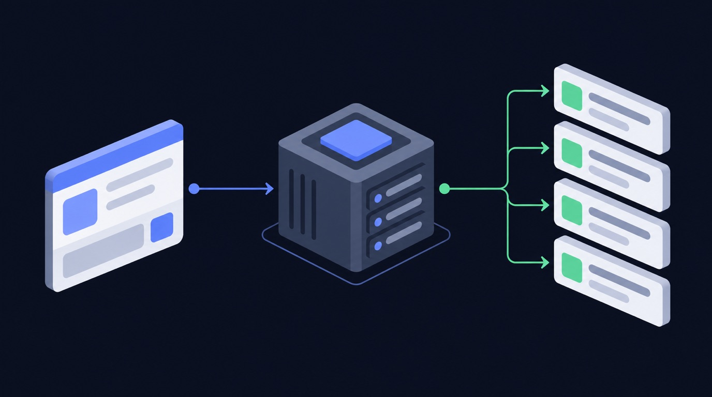

# How to get Facebook page posts data

Pulling Facebook page posts data by hand does not scale. You either copy-paste it one item at a time, or you fight the API — rate limits, auth, and pagination — and still end up with half the fields missing. For a social media manager, the data only matters if it is complete, fresh, and in a sheet you can act on. That is the gap Facebook Page Posts Scraper · No Cookies closes.

> **Facebook Page Posts Scraper · No Cookies** runs **329 times a month** on Apify.

## What you get

- No cookies, no authentication
- reactions by type (like
- author profiles
- media attachments

Instead of building a scraper, you point **Facebook Page Posts Scraper · No Cookies** ([`data-slayer/facebook-page-posts`](https://apify.com/data-slayer/facebook-page-posts)) at your input and run it. It handles the requests, retries, and parsing, and returns one clean row per item in the format you already use.

## How it works — step by step

**1. Open the actor**
Go to [`data-slayer/facebook-page-posts`](https://apify.com/data-slayer/facebook-page-posts?utm_source=github&utm_medium=use-case&utm_campaign=how-to-get-facebook-page-posts-data) and click **Try for free**.

**2. Paste your input**
```json
{
  "pageId": "100064860875397"
}
```

**3. Run it**
Click **Start**. A typical run finishes in under a minute and returns one row per item.

**4. Get your data**
Download as **JSON, CSV, or Excel**, or push straight to Google Sheets / Airtable via the built-in integrations.

### What the output looks like

| Field | Example | Use it for |
|---|---|---|
| `url` | `https://…/item/ABC123` | link back to the source |
| `caption` | `"…"` | content analysis |
| `engagement` | `…` | filter / sort / export |
| `collectedAt` | `2026-09-30T12:00:00Z` | time-series / scheduling |

## Why scraping Facebook page posts without getting blocked is hard in 2026

Facebook is one of the most aggressively defended sites on the web, and 2026 is the hardest
year yet to pull Facebook data at scale. If you have tried to **scrape Facebook** yourself, you have
probably already hit one of these walls:

- **Anti-bot detection.** Facebook fingerprints the TLS handshake, the HTTP headers, and the
  request timing of every client. A plain `requests` call is flagged before it ever reaches
  a public profile, and you **get blocked** with a login wall or an empty response.
- **Rate limits.** The public endpoints throttle by IP and by session. Hit the rate limit
  and the API returns errors for minutes; ignore it and the account or IP is temporarily
  banned.
- **Login walls and cookies.** Many surfaces (stories, some reels, follower lists) are only
  served to a logged-in session, so a naive scraper needs a real login, a cookie jar, and a
  way to refresh it — which is exactly what gets accounts disabled.
- **Pagination and shifting JSON.** Facebook changes its private JSON shape without notice, so a
  scraper you wrote last quarter silently returns half the fields today.

That is the difference between a script that works once on your laptop and a **Facebook scraper**
that runs every day without maintenance. For a page posts job you do not want to babysit
proxies, cookies, and retries — you want the rows.

## Three ways to get Facebook data — and which one to use

There are three honest ways to get Facebook page posts data in 2026. Each has a real cost.


<!-- art-auto -->


| Approach | How it works | The catch |
|---|---|---|
| **Build your own scraper** | Write a Python scraper with `requests`, rotate residential proxies, manage a login session, parse the private JSON | Weeks of work, constant breakage, and you own the block/ban risk. Fine for a one-off, painful at scale. |
| **Official Facebook API** | Use the platform's own API | Heavily restricted, requires app review, returns a fraction of the public fields, and is not built for bulk extraction. |
| **A ready-made scraping API / actor** | Point a maintained actor at your input and download clean rows | You pay per result, but you skip the proxy, login, and parsing work entirely. |

For most page posts work the third option wins on total cost. A **scraping API** gives you the
same **public Facebook data** a hand-built Python scraper would, without the account-handling
system around it. **Apify** hosts these actors and exposes them through a **web scraping
API**, so you can run one by hand, on a schedule, or from code with the **Apify API**.

## How to scrape Facebook page posts without getting blocked

If you do build your own **Facebook scraper**, these are the controls that actually keep it
alive. Every one of them is already handled for you inside a maintained actor.

1. **Use residential proxies.** Datacenter IP ranges are blocked on sight. Rotate
   **residential proxies** per request so no single IP crosses the rate limit.
2. **Respect the rate limit.** Throttle to a concurrency the target tolerates, and back off
   exponentially when you see a 429. A conservative rate limit beats a fast ban.
3. **Send real headers and a warm session.** Match a browser's headers, keep a cookie jar,
   and reuse a session instead of opening a cold connection every call.
4. **Retry with jitter.** Transient failures are normal; retry with exponential backoff and
   random jitter, and treat an empty body as a failure, not a result.
5. **Page carefully.** Follow cursors to the end, dedupe by id, and stop cleanly when the
   feed ends — do not hammer the same page.
6. **Cache what you already have.** Re-fetch only new items. Most "blocks" are self-inflicted
   by re-scraping the same public profile hundreds of times.

Do all six and you can **scrape Facebook without getting blocked** for a while. Do none of them
and you will **get blocked** on day one. That maintenance burden is the real reason teams
move to a hosted **Facebook scraper** instead of owning the plumbing.

## What you can do with Facebook page posts data

Once the rows land in a sheet, the data does the work. Four patterns we see most:



<!-- art-auto -->


- **Competitor benchmarking.** Track the engagement metrics of a competitor's public posts
  over time and see what format wins in your niche.
- **Creator and lead discovery.** Pull the public profiles behind a hashtag or keyword and
  build a shortlist of creators to work with.
- **Content research.** Export the top posts for a topic, cluster their captions and
  hashtags, and use the winners as a brief for your own content.
- **Reporting and monitoring.** Schedule the actor daily, push to Google Sheets, and let a
  dashboard refresh itself instead of paying an analyst to copy-paste numbers.

All of it runs on **public data** — no login, no personal data, and no private accounts.

## Is scraping Facebook page posts legal?

Scraping **public Facebook data** is generally lawful in most jurisdictions, but the rules are
not uniform and they change. A few principles keep you on the right side of it:

- **Public data only.** If a field is visible to a logged-out visitor, it is fair game in
  most readings; private profiles, DMs, and anything behind a login are not.
- **Mind privacy law.** GDPR, CCPA, and similar regimes still govern how you *store and
  process* personal data even when you collected it lawfully. Do not build profiles of
  individuals from public data without a lawful basis.
- **Respect terms and robots.** Follow the platform's terms and its `robots.txt`, and never
  use scraped data to harass, spam, or re-identify people.
- **Keep it proportionate.** A steady, modest rate limit is both more ethical and more
  durable than a burst that degrades the service for everyone.

This article is not legal advice. When the use case is commercial and the data is personal,
get a lawyer's read before you scale.

## Best Facebook scraper: how to choose one in 2026

Search for the **best Facebook scraper** and you get a wall of tools. The **best Facebook scraper**
for your job comes down to four questions:


<!-- art-auto -->


- **Does it run logged out?** If a tool needs your Facebook login, it is putting your account at
  risk. A good **Facebook scraper** reads public data without a session.
- **Does it handle the blocking for you?** Residential proxies, retries, and pacing should
  be the tool's problem, not yours.
- **Does it return the fields you need?** A tool that returns ten fields when you need
  fifty is a false economy.
- **Can you schedule it?** The value compounds when the data refreshes itself.

Across the **Facebook scrapers in 2026**, the ones that last are maintained, logged-out, and
API-first. That is the design of the actor on this page.

## What you can extract from Facebook URLs, posts, reels and hashtags

The unit of work is a **Facebook URL** or handle. From those you can **extract Facebook** data
across every public surface:

- **Posts and reels** — captions, media, view counts, and engagement metrics.
- **Comments** — the public comment thread, with authors and timestamps.
- **Hashtags** — the public posts behind a **hashtag**, for trend and creator research.
- **Profiles** — the **public profile** fields a logged-out visitor can see.

You hand the actor the **Facebook URLs** you care about and it returns one row per item. Because
it is a single **Facebook scraper API**, the same call works for posts, reels, comments, and
hashtags — you do not stitch together four tools.

## Facebook scraping API vs Bright Data vs a custom build

If you have looked at **Bright Data** or another **scraping API**, the trade-off is the
same everywhere: a **web scraping API** sells you the unblocking layer, and you still own
the parsing. A hosted **Facebook scraper API** goes one step further — it returns the parsed
page posts rows, not just the HTML.

| | Custom Python build | Bright Data / raw proxy | Hosted actor |
|---|---|---|---|
| Unblocking | you build it | included | included |
| Parsing to fields | you build it | you build it | included |
| Maintenance | ongoing | low | vendor |
| Time to first row | days | hours | minutes |

**Social media scraping** is a maintenance problem, not a one-off script. The cheapest
line item is almost never the one that costs you a week of engineering every quarter.

## Facebook page posts terms, explained

A quick reference for the terms this guide uses:

- **privacy policy** — part of the Facebook page posts data you get back. A run returns privacy policy for every row.
- **graph** — part of the Facebook page posts data you get back. A run returns graph for every row.
- **terms of service** — part of the Facebook page posts data you get back. A run returns terms of service for every row.
- **generated by ai** — part of the Facebook page posts data you get back. A run returns generated by ai for every row.

Readers also search for data extraction, stack overflow, stack, page name, web data, data scraper, extract public, post urls, structure, graph api, scrape posts, automation, post url, via api, facebook's, types of posts, number of comments, post content, publicly available data, search results, chrome extension, data points, data pipelines, structured data, spreadsheet, automate, browser automation, webpage, number of likes, public business, conversations about products, analytics, serp api, market research, third-party — the same actor answers all of it.

## Facebook page posts: developer, facebook post, post data, and scraper api

Teams evaluating Facebook page posts work through developer, facebook post, post data, scraper api. Each shapes how the data is gathered and used.

## web data, platform, facebook scrapers, and public facebook

Teams evaluating Facebook page posts work through web data, platform, facebook scrapers, public facebook. Each shapes how the data is gathered and used.

## structure, graph, graph api, and automation

Teams evaluating Facebook page posts work through structure, graph, graph api, automation. Each shapes how the data is gathered and used.

## way to scrape, generated by ai, extract post, and facebook api

Teams evaluating Facebook page posts work through way to scrape, generated by ai, extract post, facebook api. Each shapes how the data is gathered and used.

## FAQ

**Can I scrape Facebook without logging in?**
Yes — for public Facebook data you do not need a login or cookies. The actor runs logged out on your side, which is exactly what keeps your own account safe.

**Does Facebook block scraping?**
Facebook blocks naive scrapers aggressively: datacenter IPs, cold sessions, and fast bursts all get flagged. A maintained **Facebook scraper** rotates residential proxies, paces itself under the rate limit, and retries cleanly, so it does not get blocked.

**Do I need coding skills to scrape Facebook data?**
No. You paste your input into the actor's form and click Start — no Python, no proxy setup, no cookie handling. Developers can still drive the same actor through the **Apify API**.

**How much does it cost to scrape Facebook page posts?**
You pay Apify compute plus a small per-result price; check the actor's Pricing tab for the exact rate. The free tier covers small runs, so you can test before you commit.

**Can I export Facebook page posts to CSV or Excel?**
Yes — download as JSON, CSV, or Excel, or connect Google Sheets / Airtable directly from the actor page: https://apify.com/data-slayer/facebook-page-posts

**Best way to scrape all of a facebook page posts including images and videos?**
Short answer: run **Facebook Page Posts Scraper · No Cookies** on your Facebook page posts input — it returns clean rows without a login. Full detail is above.

**Can AI agents use the Facebook Posts Scraper API?**
Open [data-slayer/facebook-page-posts](https://apify.com/data-slayer/facebook-page-posts), paste your input, and click Start; developers can also call the same actor through the **Apify API**.

**Can Facebook Page data be exported to Excel?**
Short answer: run **Facebook Page Posts Scraper · No Cookies** on your Facebook page posts input — it returns clean rows without a login. Full detail is above.

**Can I use the Facebook Posts Scraper API for competitive analysis?**
Open [data-slayer/facebook-page-posts](https://apify.com/data-slayer/facebook-page-posts), paste your input, and click Start; developers can also call the same actor through the **Apify API**.

**Comparing scraping platforms?**
Open [data-slayer/facebook-page-posts](https://apify.com/data-slayer/facebook-page-posts), paste your input, and click Start; developers can also call the same actor through the **Apify API**.

**Do you know any (free) tools to download posts from Facebook?**
Short answer: run **Facebook Page Posts Scraper · No Cookies** on your Facebook page posts input — it returns clean rows without a login. Full detail is above.

**Do you provide support for the Facebook Posts Scraper API?**
Open [data-slayer/facebook-page-posts](https://apify.com/data-slayer/facebook-page-posts), paste your input, and click Start; developers can also call the same actor through the **Apify API**.

**Does a manual social media planner for Facebook group posting already exist?**
Short answer: run **Facebook Page Posts Scraper · No Cookies** on your Facebook page posts input — it returns clean rows without a login. Full detail is above.

**How can I integrate the Facebook Posts Scraper API with my existing systems?**
Yes — export to CSV/JSON/Excel or wire it to Google Sheets, Airtable, Zapier, or the Apify API for a hands-off pipeline.

**How does the Facebook Posts Scraper API work?**
Open [data-slayer/facebook-page-posts](https://apify.com/data-slayer/facebook-page-posts), paste your input, and click Start; developers can also call the same actor through the **Apify API**.

**How to download facebook photos and videos?**
Short answer: run **Facebook Page Posts Scraper · No Cookies** on your Facebook page posts input — it returns clean rows without a login. Full detail is above.

**How to extract Facebook posts with name, message, and link?**
Short answer: run **Facebook Page Posts Scraper · No Cookies** on your Facebook page posts input — it returns clean rows without a login. Full detail is above.

**How to fetch the all the post data from Facebook?**
Short answer: run **Facebook Page Posts Scraper · No Cookies** on your Facebook page posts input — it returns clean rows without a login. Full detail is above.

**Is Facebook Post Scraper legal to use?**
Scraping **public Facebook data** is generally legal; private data and personal data have rules. See the legality section above, and get legal advice for commercial use.

**Is the Facebook Posts Scraper API compliant with data protection regulations?**
Open [data-slayer/facebook-page-posts](https://apify.com/data-slayer/facebook-page-posts), paste your input, and click Start; developers can also call the same actor through the **Apify API**.

**Is there API(s) that can retrieve information based on a URL of a **public** post/story from Facebook/Instagram/Twitter/Tiktok?**
Open [data-slayer/facebook-page-posts](https://apify.com/data-slayer/facebook-page-posts), paste your input, and click Start; developers can also call the same actor through the **Apify API**.

**Is there a free tier available for the Facebook Posts Scraper API?**
Open [data-slayer/facebook-page-posts](https://apify.com/data-slayer/facebook-page-posts), paste your input, and click Start; developers can also call the same actor through the **Apify API**.

**What Is a Facebook Page Scraper?**
Short answer: run **Facebook Page Posts Scraper · No Cookies** on your Facebook page posts input — it returns clean rows without a login. Full detail is above.

**What Public Facebook Page Data Can You Extract?**
Short answer: run **Facebook Page Posts Scraper · No Cookies** on your Facebook page posts input — it returns clean rows without a login. Full detail is above.

**What are free tools to download Facebook posts for analysis?**
Short answer: run **Facebook Page Posts Scraper · No Cookies** on your Facebook page posts input — it returns clean rows without a login. Full detail is above.

**What are social media APIs for retrieving public post information?**
Open [data-slayer/facebook-page-posts](https://apify.com/data-slayer/facebook-page-posts), paste your input, and click Start; developers can also call the same actor through the **Apify API**.

**What are the usage limits for the Facebook Posts Scraper API?**
Open [data-slayer/facebook-page-posts](https://apify.com/data-slayer/facebook-page-posts), paste your input, and click Start; developers can also call the same actor through the **Apify API**.

## Who this is for

If you are a **social media manager**, this replaces the manual Facebook page posts pull. Run it on a schedule, push the output to Sheets or Airtable, and your report refreshes itself.

## Related use cases

- [facebook marketplace scraper](https://dataslayer.dev/use-cases/facebook-marketplace-scraper/)
- [how to scrape facebook page posts without getting blocked](https://dataslayer.dev/use-cases/how-to-scrape-facebook-page-posts-without-getting-blocked/)
- [how to scrape facebook page without getting blocked](https://dataslayer.dev/use-cases/how-to-scrape-facebook-page-without-getting-blocked/)

## Try it now

Ready to run it yourself? **[Open Facebook Page Posts Scraper · No Cookies on Apify →](https://apify.com/data-slayer/facebook-page-posts?utm_source=github&utm_medium=use-case&utm_campaign=how-to-get-facebook-page-posts-data)**

No login, no code. Free tier included.

---

<!-- status: draft. NEURONwriter brief (neuronwriter_brief_id) + score (neuronwriter_score)
     still owed before publish; gate = score >= 70. -->
