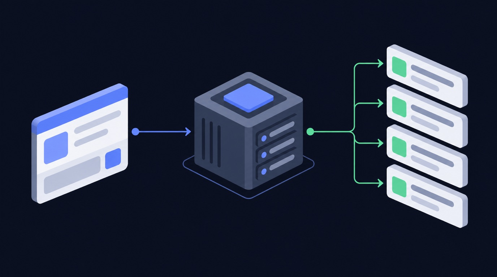

# How to get X (Twitter) followings data

Pulling Twitter followings data by hand does not scale. You either copy-paste it one item at a time, or you fight the API — rate limits, auth, and pagination — and still end up with half the fields missing. For a social media manager, the data only matters if it is complete, fresh, and in a sheet you can act on. That is the gap Twitter/X Following Scraper · Public Profiles closes.

> **Twitter/X Following Scraper · Public Profiles** runs **206 times a month** on Apify.

## What you get

- Export a bounded, deduplicated list of accounts followed by a public Twitter/X profile
- Accept usernames, profile URLs, and numeric user IDs; download profile records as JSON, CSV, or Excel
- deduplicated list of accounts followed by a public Twitter/X profile. Accept usernames

Instead of building a scraper, you point **Twitter/X Following Scraper · Public Profiles** ([`data-slayer/twitter-followings`](https://apify.com/data-slayer/twitter-followings)) at your input and run it. It handles the requests, retries, and parsing, and returns one clean row per item in the format you already use.

## How it works — step by step

**1. Open the actor**
Go to [`data-slayer/twitter-followings`](https://apify.com/data-slayer/twitter-followings?utm_source=github&utm_medium=use-case&utm_campaign=how-to-get-twitter-followings-data) and click **Try for free**.

**2. Paste your input**
```json
{
  "userId": "elonmusk"
}
```

**3. Run it**
Click **Start**. A typical run finishes in under a minute and returns one row per item.

**4. Get your data**
Download as **JSON, CSV, or Excel**, or push straight to Google Sheets / Airtable via the built-in integrations.

### What the output looks like

| Field | Example | Use it for |
|---|---|---|
| `url` | `https://…/item/ABC123` | link back to the source |
| `caption` | `"…"` | content analysis |
| `engagement` | `…` | filter / sort / export |
| `collectedAt` | `2026-09-30T12:00:00Z` | time-series / scheduling |

## Why scraping Twitter followings without getting blocked is hard in 2026

Twitter is one of the most aggressively defended sites on the web, and 2026 is the hardest
year yet to pull Twitter data at scale. If you have tried to **scrape Twitter** yourself, you have
probably already hit one of these walls:

- **Anti-bot detection.** Twitter fingerprints the TLS handshake, the HTTP headers, and the
  request timing of every client. A plain `requests` call is flagged before it ever reaches
  a public profile, and you **get blocked** with a login wall or an empty response.
- **Rate limits.** The public endpoints throttle by IP and by session. Hit the rate limit
  and the API returns errors for minutes; ignore it and the account or IP is temporarily
  banned.
- **Login walls and cookies.** Many surfaces (stories, some reels, follower lists) are only
  served to a logged-in session, so a naive scraper needs a real login, a cookie jar, and a
  way to refresh it — which is exactly what gets accounts disabled.
- **Pagination and shifting JSON.** Twitter changes its private JSON shape without notice, so a
  scraper you wrote last quarter silently returns half the fields today.

That is the difference between a script that works once on your laptop and a **Twitter scraper**
that runs every day without maintenance. For a followings job you do not want to babysit
proxies, cookies, and retries — you want the rows.

## Three ways to get Twitter data — and which one to use

There are three honest ways to get Twitter followings data in 2026. Each has a real cost.


<!-- art-auto -->


| Approach | How it works | The catch |
|---|---|---|
| **Build your own scraper** | Write a Python scraper with `requests`, rotate residential proxies, manage a login session, parse the private JSON | Weeks of work, constant breakage, and you own the block/ban risk. Fine for a one-off, painful at scale. |
| **Official Twitter API** | Use the platform's own API | Heavily restricted, requires app review, returns a fraction of the public fields, and is not built for bulk extraction. |
| **A ready-made scraping API / actor** | Point a maintained actor at your input and download clean rows | You pay per result, but you skip the proxy, login, and parsing work entirely. |

For most followings work the third option wins on total cost. A **scraping API** gives you the
same **public Twitter data** a hand-built Python scraper would, without the account-handling
system around it. **Apify** hosts these actors and exposes them through a **web scraping
API**, so you can run one by hand, on a schedule, or from code with the **Apify API**.

## How to scrape Twitter followings without getting blocked

If you do build your own **Twitter scraper**, these are the controls that actually keep it
alive. Every one of them is already handled for you inside a maintained actor.

1. **Use residential proxies.** Datacenter IP ranges are blocked on sight. Rotate
   **residential proxies** per request so no single IP crosses the rate limit.
2. **Respect the rate limit.** Throttle to a concurrency the target tolerates, and back off
   exponentially when you see a 429. A conservative rate limit beats a fast ban.
3. **Send real headers and a warm session.** Match a browser's headers, keep a cookie jar,
   and reuse a session instead of opening a cold connection every call.
4. **Retry with jitter.** Transient failures are normal; retry with exponential backoff and
   random jitter, and treat an empty body as a failure, not a result.
5. **Page carefully.** Follow cursors to the end, dedupe by id, and stop cleanly when the
   feed ends — do not hammer the same page.
6. **Cache what you already have.** Re-fetch only new items. Most "blocks" are self-inflicted
   by re-scraping the same public profile hundreds of times.

Do all six and you can **scrape Twitter without getting blocked** for a while. Do none of them
and you will **get blocked** on day one. That maintenance burden is the real reason teams
move to a hosted **Twitter scraper** instead of owning the plumbing.

## What you can do with Twitter followings data

Once the rows land in a sheet, the data does the work. Four patterns we see most:



<!-- art-auto -->


- **Competitor benchmarking.** Track the engagement metrics of a competitor's public posts
  over time and see what format wins in your niche.
- **Creator and lead discovery.** Pull the public profiles behind a hashtag or keyword and
  build a shortlist of creators to work with.
- **Content research.** Export the top posts for a topic, cluster their captions and
  hashtags, and use the winners as a brief for your own content.
- **Reporting and monitoring.** Schedule the actor daily, push to Google Sheets, and let a
  dashboard refresh itself instead of paying an analyst to copy-paste numbers.

All of it runs on **public data** — no login, no personal data, and no private accounts.

## Is scraping Twitter followings legal?

Scraping **public Twitter data** is generally lawful in most jurisdictions, but the rules are
not uniform and they change. A few principles keep you on the right side of it:

- **Public data only.** If a field is visible to a logged-out visitor, it is fair game in
  most readings; private profiles, DMs, and anything behind a login are not.
- **Mind privacy law.** GDPR, CCPA, and similar regimes still govern how you *store and
  process* personal data even when you collected it lawfully. Do not build profiles of
  individuals from public data without a lawful basis.
- **Respect terms and robots.** Follow the platform's terms and its `robots.txt`, and never
  use scraped data to harass, spam, or re-identify people.
- **Keep it proportionate.** A steady, modest rate limit is both more ethical and more
  durable than a burst that degrades the service for everyone.

This article is not legal advice. When the use case is commercial and the data is personal,
get a lawyer's read before you scale.

## Best Twitter scraper: how to choose one in 2026

Search for the **best Twitter scraper** and you get a wall of tools. The **best Twitter scraper**
for your job comes down to four questions:


<!-- art-auto -->


- **Does it run logged out?** If a tool needs your Twitter login, it is putting your account at
  risk. A good **Twitter scraper** reads public data without a session.
- **Does it handle the blocking for you?** Residential proxies, retries, and pacing should
  be the tool's problem, not yours.
- **Does it return the fields you need?** A tool that returns ten fields when you need
  fifty is a false economy.
- **Can you schedule it?** The value compounds when the data refreshes itself.

Across the **Twitter scrapers in 2026**, the ones that last are maintained, logged-out, and
API-first. That is the design of the actor on this page.

## What you can extract from Twitter URLs, posts, reels and hashtags

The unit of work is a **Twitter URL** or handle. From those you can **extract Twitter** data
across every public surface:

- **Posts and reels** — captions, media, view counts, and engagement metrics.
- **Comments** — the public comment thread, with authors and timestamps.
- **Hashtags** — the public posts behind a **hashtag**, for trend and creator research.
- **Profiles** — the **public profile** fields a logged-out visitor can see.

You hand the actor the **Twitter URLs** you care about and it returns one row per item. Because
it is a single **Twitter scraper API**, the same call works for posts, reels, comments, and
hashtags — you do not stitch together four tools.

## Twitter scraping API vs Bright Data vs a custom build

If you have looked at **Bright Data** or another **scraping API**, the trade-off is the
same everywhere: a **web scraping API** sells you the unblocking layer, and you still own
the parsing. A hosted **Twitter scraper API** goes one step further — it returns the parsed
followings rows, not just the HTML.

| | Custom Python build | Bright Data / raw proxy | Hosted actor |
|---|---|---|---|
| Unblocking | you build it | included | included |
| Parsing to fields | you build it | you build it | included |
| Maintenance | ongoing | low | vendor |
| Time to first row | days | hours | minutes |

**Social media scraping** is a maintenance problem, not a one-off script. The cheapest
line item is almost never the one that costs you a week of engineering every quarter.

## Twitter followings terms, explained

A quick reference for the terms this guide uses:

- **follower** — a public follower count you can rank by. A run returns follower for every row.
- **follower count** — a public follower count you can rank by. A run returns follower count for every row.
- **analytics** — the likes, comments, views, and shares on an item. A run returns analytics for every row.
- **bio** — part of the Twitter followings data you get back. A run returns bio for every row.

Readers also search for number of followers, follower growth, twitter analytics, circleboom, twitter profile, track followers, twitter follower count, twitter follower analysis, followers and following, track twitter followers, x developers, complete follower, use the search bar, twitter’s, account’s, twitter's, sort followers, follower tracking, workflow, x api, dataset, fedica, track follower growth, best twitter follower, followers of any twitter, retweets, using a twitter follower, another account, oauth, v1.1, analysis tools, get followers, api access, daily follower, followers and unfollowers, formerly twitter, free account, understand your audience, x analytics, specific account, social media strategy, start collecting, verified accounts, rate-limit, inactive accounts, hashtag analytics, native analytics, unfollowing, andypiper, competitive analysis, geographic distribution, valuable insights — the same actor answers all of it.

## Twitter followings: follower, twitter follower, fedica, and twitter account

Teams evaluating Twitter followings work through follower, twitter follower, fedica, twitter account. Each shapes how the data is gathered and used.

## follower count, twitter user, tweet, and follower growth

Teams evaluating Twitter followings work through follower count, twitter user, tweet, follower growth. Each shapes how the data is gathered and used.

## circleboom, track followers, twitter follower count, and track twitter followers

Teams evaluating Twitter followings work through circleboom, track followers, twitter follower count, track twitter followers. Each shapes how the data is gathered and used.

## track follower growth, best twitter follower, another account, and andypiper

Teams evaluating Twitter followings work through track follower growth, best twitter follower, another account, andypiper. Each shapes how the data is gathered and used.

## FAQ

**Can I scrape Twitter without logging in?**
Yes — for public Twitter data you do not need a login or cookies. The actor runs logged out on your side, which is exactly what keeps your own account safe.

**Does Twitter block scraping?**
Twitter blocks naive scrapers aggressively: datacenter IPs, cold sessions, and fast bursts all get flagged. A maintained **Twitter scraper** rotates residential proxies, paces itself under the rate limit, and retries cleanly, so it does not get blocked.

**Do I need coding skills to scrape Twitter data?**
No. You paste your input into the actor's form and click Start — no Python, no proxy setup, no cookie handling. Developers can still drive the same actor through the **Apify API**.

**How much does it cost to scrape Twitter followings?**
You pay Apify compute plus a small per-result price; check the actor's Pricing tab for the exact rate. The free tier covers small runs, so you can test before you commit.

**Can I export Twitter followings to CSV or Excel?**
Yes — download as JSON, CSV, or Excel, or connect Google Sheets / Airtable directly from the actor page: https://apify.com/data-slayer/twitter-followings

**Are Twitter followers worth anything?**
Short answer: run **Twitter/X Following Scraper · Public Profiles** on your Twitter followings input — it returns clean rows without a login. Full detail is above.

**Are there any good tools for managing Twitter follows - whom you follow, whom you might unfollow?**
Short answer: run **Twitter/X Following Scraper · Public Profiles** on your Twitter followings input — it returns clean rows without a login. Full detail is above.

**Are there any websites that automatically follow people back on Twitter if they follow you first?**
Short answer: run **Twitter/X Following Scraper · Public Profiles** on your Twitter followings input — it returns clean rows without a login. Full detail is above.

**But have you any magic for search like followers:screen_name?**
Short answer: run **Twitter/X Following Scraper · Public Profiles** on your Twitter followings input — it returns clean rows without a login. Full detail is above.

**But the real question is: Who exactly is following you, and when?**
Short answer: run **Twitter/X Following Scraper · Public Profiles** on your Twitter followings input — it returns clean rows without a login. Full detail is above.

**But who can sit in front of the computer and concentrate on Twitter activity all day long?**
Short answer: run **Twitter/X Following Scraper · Public Profiles** on your Twitter followings input — it returns clean rows without a login. Full detail is above.

**Can I buy a list of Twitter users?**
Short answer: run **Twitter/X Following Scraper · Public Profiles** on your Twitter followings input — it returns clean rows without a login. Full detail is above.

**Can I use automation tools to track and manage my Twitter engagement across multiple accounts at once?**
You can run the actor across the followings URLs you care about in one job and get one row per item, mixed types included.

**Can I view another user's Twitter follower statistics over time?**
Short answer: run **Twitter/X Following Scraper · Public Profiles** on your Twitter followings input — it returns clean rows without a login. Full detail is above.

**Can anyone list some Twitter accounts that're worth following?**
Short answer: run **Twitter/X Following Scraper · Public Profiles** on your Twitter followings input — it returns clean rows without a login. Full detail is above.

**Can blocked users see your following or followers list?**
The actor rotates **residential proxies**, paces under the rate limit, and retries with backoff, which is what keeps a **Twitter scraper** from getting blocked.

**Can the export include followers' recent posts or engagement on my account?**
Sort or filter the output after export; the actor returns the items for the URLs or handles you give it, and you keep the newest by timestamp.

**Can you follow back?**
Short answer: run **Twitter/X Following Scraper · Public Profiles** on your Twitter followings input — it returns clean rows without a login. Full detail is above.

**Can you hide your followers/following list on Twitter but still keep your tweets public?**
Short answer: run **Twitter/X Following Scraper · Public Profiles** on your Twitter followings input — it returns clean rows without a login. Full detail is above.

**Can you look at someone's tweets without having a Twitter account?**
Short answer: run **Twitter/X Following Scraper · Public Profiles** on your Twitter followings input — it returns clean rows without a login. Full detail is above.

**Did you decide to follow me or were added by the system?**
Short answer: run **Twitter/X Following Scraper · Public Profiles** on your Twitter followings input — it returns clean rows without a login. Full detail is above.

**Did you know that Shakira (232 friends) and Gerard Pique (763 friends) have only 25 common following accounts?**
Sort or filter the output after export; the actor returns the items for the URLs or handles you give it, and you keep the newest by timestamp.

**Do you know the language distribution of your Twitter followers?**
Short answer: run **Twitter/X Following Scraper · Public Profiles** on your Twitter followings input — it returns clean rows without a login. Full detail is above.

**Do you know the optimal time to tweet for maximum engagement with your followers?**
Short answer: run **Twitter/X Following Scraper · Public Profiles** on your Twitter followings input — it returns clean rows without a login. Full detail is above.

**Does Twitter collect user data?**
Short answer: run **Twitter/X Following Scraper · Public Profiles** on your Twitter followings input — it returns clean rows without a login. Full detail is above.

**Does Twitter follow anyone?**
Short answer: run **Twitter/X Following Scraper · Public Profiles** on your Twitter followings input — it returns clean rows without a login. Full detail is above.

**For example, do you want to know when any baseball team starts following a new player?**
Short answer: run **Twitter/X Following Scraper · Public Profiles** on your Twitter followings input — it returns clean rows without a login. Full detail is above.

## Who this is for

If you are a **social media manager**, this replaces the manual Twitter followings pull. Run it on a schedule, push the output to Sheets or Airtable, and your report refreshes itself.

## Related use cases

- [how to scrape twitter trends by location without getting blocked](https://dataslayer.dev/use-cases/how-to-scrape-twitter-trends-by-location-without-getting-blocked/)
- [how to scrape twitter followings without getting blocked](https://dataslayer.dev/use-cases/how-to-scrape-twitter-followings-without-getting-blocked/)
- [how to scrape twitter followers without getting blocked](https://dataslayer.dev/use-cases/how-to-scrape-twitter-followers-without-getting-blocked/)

## Try it now

Ready to run it yourself? **[Open Twitter/X Following Scraper · Public Profiles on Apify →](https://apify.com/data-slayer/twitter-followings?utm_source=github&utm_medium=use-case&utm_campaign=how-to-get-twitter-followings-data)**

No login, no code. Free tier included.

---

<!-- status: draft. NEURONwriter brief (neuronwriter_brief_id) + score (neuronwriter_score)
     still owed before publish; gate = score >= 70. -->
