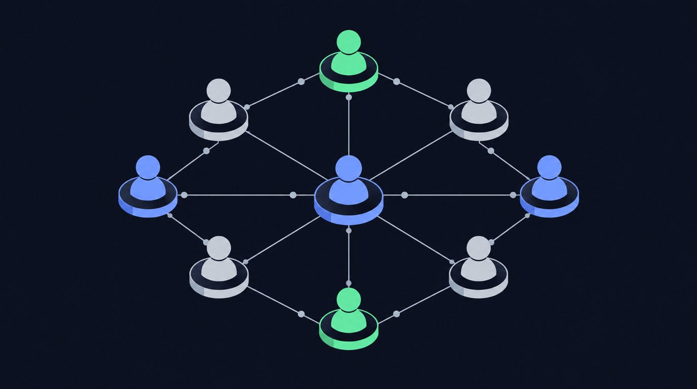

# Instagram followers scraper

Pulling Instagram followers data by hand does not scale. You either copy-paste it one item at a time, or you fight the API — rate limits, auth, and pagination — and still end up with half the fields missing. For a social media manager, the data only matters if it is complete, fresh, and in a sheet you can act on. That is the gap Instagram Followers Scraper & Enricher · No Login closes.

> **Instagram Followers Scraper & Enricher · No Login** runs **510 times a month** on Apify.

## What you get

- 31 fields per result
- SocialScraper alternative
- pay per result
- Optional MillionVerifier email verification

Instead of building a scraper, you point **Instagram Followers Scraper & Enricher · No Login** ([`data-slayer/instagram-followers-scraper---no-login`](https://apify.com/data-slayer/instagram-followers-scraper---no-login)) at your input and run it. It handles the requests, retries, and parsing, and returns one clean row per item in the format you already use.

## How it works — step by step

**1. Open the actor**
Go to [`data-slayer/instagram-followers-scraper---no-login`](https://apify.com/data-slayer/instagram-followers-scraper---no-login?utm_source=github&utm_medium=use-case&utm_campaign=instagram-followers-scraper) and click **Try for free**.

**2. Paste your input**
```json
{
  "username": "natgeo"
}
```

**3. Run it**
Click **Start**. A typical run finishes in under a minute and returns one row per item.

**4. Get your data**
Download as **JSON, CSV, or Excel**, or push straight to Google Sheets / Airtable via the built-in integrations.

### What the output looks like

| Field | Example | Use it for |
|---|---|---|
| `per result` | `…` | filter / sort / export |

## Why scraping Instagram followers without getting blocked is hard in 2026

Instagram is one of the most aggressively defended sites on the web, and 2026 is the hardest
year yet to pull Instagram data at scale. If you have tried to **scrape Instagram** yourself, you have
probably already hit one of these walls:

- **Anti-bot detection.** Instagram fingerprints the TLS handshake, the HTTP headers, and the
  request timing of every client. A plain `requests` call is flagged before it ever reaches
  a public profile, and you **get blocked** with a login wall or an empty response.
- **Rate limits.** The public endpoints throttle by IP and by session. Hit the rate limit
  and the API returns errors for minutes; ignore it and the account or IP is temporarily
  banned.
- **Login walls and cookies.** Many surfaces (stories, some reels, follower lists) are only
  served to a logged-in session, so a naive scraper needs a real login, a cookie jar, and a
  way to refresh it — which is exactly what gets accounts disabled.
- **Pagination and shifting JSON.** Instagram changes its private JSON shape without notice, so a
  scraper you wrote last quarter silently returns half the fields today.

That is the difference between a script that works once on your laptop and a **Instagram scraper**
that runs every day without maintenance. For a followers job you do not want to babysit
proxies, cookies, and retries — you want the rows.

## Three ways to get Instagram data — and which one to use

There are three honest ways to get Instagram followers data in 2026. Each has a real cost.


<!-- art-auto -->


| Approach | How it works | The catch |
|---|---|---|
| **Build your own scraper** | Write a Python scraper with `requests`, rotate residential proxies, manage a login session, parse the private JSON | Weeks of work, constant breakage, and you own the block/ban risk. Fine for a one-off, painful at scale. |
| **Official Instagram API** | Use the platform's own API | Heavily restricted, requires app review, returns a fraction of the public fields, and is not built for bulk extraction. |
| **A ready-made scraping API / actor** | Point a maintained actor at your input and download clean rows | You pay per result, but you skip the proxy, login, and parsing work entirely. |

For most followers work the third option wins on total cost. A **scraping API** gives you the
same **public Instagram data** a hand-built Python scraper would, without the account-handling
system around it. **Apify** hosts these actors and exposes them through a **web scraping
API**, so you can run one by hand, on a schedule, or from code with the **Apify API**.

## How to scrape Instagram followers without getting blocked

If you do build your own **Instagram scraper**, these are the controls that actually keep it
alive. Every one of them is already handled for you inside a maintained actor.

1. **Use residential proxies.** Datacenter IP ranges are blocked on sight. Rotate
   **residential proxies** per request so no single IP crosses the rate limit.
2. **Respect the rate limit.** Throttle to a concurrency the target tolerates, and back off
   exponentially when you see a 429. A conservative rate limit beats a fast ban.
3. **Send real headers and a warm session.** Match a browser's headers, keep a cookie jar,
   and reuse a session instead of opening a cold connection every call.
4. **Retry with jitter.** Transient failures are normal; retry with exponential backoff and
   random jitter, and treat an empty body as a failure, not a result.
5. **Page carefully.** Follow cursors to the end, dedupe by id, and stop cleanly when the
   feed ends — do not hammer the same page.
6. **Cache what you already have.** Re-fetch only new items. Most "blocks" are self-inflicted
   by re-scraping the same public profile hundreds of times.

Do all six and you can **scrape Instagram without getting blocked** for a while. Do none of them
and you will **get blocked** on day one. That maintenance burden is the real reason teams
move to a hosted **Instagram scraper** instead of owning the plumbing.

## What you can do with Instagram followers data

Once the rows land in a sheet, the data does the work. Four patterns we see most:



<!-- art-auto -->


- **Competitor benchmarking.** Track the engagement metrics of a competitor's public posts
  over time and see what format wins in your niche.
- **Creator and lead discovery.** Pull the public profiles behind a hashtag or keyword and
  build a shortlist of creators to work with.
- **Content research.** Export the top posts for a topic, cluster their captions and
  hashtags, and use the winners as a brief for your own content.
- **Reporting and monitoring.** Schedule the actor daily, push to Google Sheets, and let a
  dashboard refresh itself instead of paying an analyst to copy-paste numbers.

All of it runs on **public data** — no login, no personal data, and no private accounts.

## Is scraping Instagram followers legal?

Scraping **public Instagram data** is generally lawful in most jurisdictions, but the rules are
not uniform and they change. A few principles keep you on the right side of it:

- **Public data only.** If a field is visible to a logged-out visitor, it is fair game in
  most readings; private profiles, DMs, and anything behind a login are not.
- **Mind privacy law.** GDPR, CCPA, and similar regimes still govern how you *store and
  process* personal data even when you collected it lawfully. Do not build profiles of
  individuals from public data without a lawful basis.
- **Respect terms and robots.** Follow the platform's terms and its `robots.txt`, and never
  use scraped data to harass, spam, or re-identify people.
- **Keep it proportionate.** A steady, modest rate limit is both more ethical and more
  durable than a burst that degrades the service for everyone.

This article is not legal advice. When the use case is commercial and the data is personal,
get a lawyer's read before you scale.

## Best Instagram scraper: how to choose one in 2026

Search for the **best Instagram scraper** and you get a wall of tools. The **best Instagram scraper**
for your job comes down to four questions:


<!-- art-auto -->


- **Does it run logged out?** If a tool needs your Instagram login, it is putting your account at
  risk. A good **Instagram scraper** reads public data without a session.
- **Does it handle the blocking for you?** Residential proxies, retries, and pacing should
  be the tool's problem, not yours.
- **Does it return the fields you need?** A tool that returns ten fields when you need
  fifty is a false economy.
- **Can you schedule it?** The value compounds when the data refreshes itself.

Across the **Instagram scrapers in 2026**, the ones that last are maintained, logged-out, and
API-first. That is the design of the actor on this page.

## What you can extract from Instagram URLs, posts, reels and hashtags

The unit of work is a **Instagram URL** or handle. From those you can **extract Instagram** data
across every public surface:

- **Posts and reels** — captions, media, view counts, and engagement metrics.
- **Comments** — the public comment thread, with authors and timestamps.
- **Hashtags** — the public posts behind a **hashtag**, for trend and creator research.
- **Profiles** — the **public profile** fields a logged-out visitor can see.

You hand the actor the **Instagram URLs** you care about and it returns one row per item. Because
it is a single **Instagram scraper API**, the same call works for posts, reels, comments, and
hashtags — you do not stitch together four tools.

## Instagram scraping API vs Bright Data vs a custom build

If you have looked at **Bright Data** or another **scraping API**, the trade-off is the
same everywhere: a **web scraping API** sells you the unblocking layer, and you still own
the parsing. A hosted **Instagram scraper API** goes one step further — it returns the parsed
followers rows, not just the HTML.

| | Custom Python build | Bright Data / raw proxy | Hosted actor |
|---|---|---|---|
| Unblocking | you build it | included | included |
| Parsing to fields | you build it | you build it | included |
| Maintenance | ongoing | low | vendor |
| Time to first row | days | hours | minutes |

**Social media scraping** is a maintenance problem, not a one-off script. The cheapest
line item is almost never the one that costs you a week of engineering every quarter.

## Instagram followers terms, explained

A quick reference for the terms this guide uses:

- **influencer** — part of the Instagram followers data you get back. A run returns influencer for every row.
- **profile data** — the public profile or page you point the actor at. A run returns profile data for every row.
- **usernames** — part of the Instagram followers data you get back. A run returns usernames for every row.
- **follower or following** — a public follower count you can rank by. A run returns follower or following for every row.
- **workflow** — the scheduled pipeline the actor plugs into. A run returns workflow for every row.
- **lead generation** — part of the Instagram followers data you get back. A run returns lead generation for every row.
- **profile url** — the address of the item you want to pull. A run returns profile url for every row.
- **number of followers** — a public follower count you can rank by. A run returns number of followers for every row.
- **verification status** — part of the Instagram followers data you get back. A run returns verification status for every row.
- **full name** — part of the Instagram followers data you get back. A run returns full name for every row.
- **public account** — the public profile or page you point the actor at. A run returns public account for every row.
- **competitor research** — part of the Instagram followers data you get back. A run returns competitor research for every row.
- **dataset** — the file or dataset you download when the run finishes. A run returns dataset for every row.
- **data extraction** — part of the Instagram followers data you get back. A run returns data extraction for every row.
- **competitor analysis** — part of the Instagram followers data you get back. A run returns competitor analysis for every row.
- **without requiring** — part of the Instagram followers data you get back. A run returns without requiring for every row.
- **influencer research** — part of the Instagram followers data you get back. A run returns influencer research for every row.
- **api support** — the programmatic way to run the Instagram followers actor on a schedule. A run returns api support for every row.

Readers also search for follower scrapers, follower data, instagram follower data, public instagram account, instagram followers or following, instagram users, followers and following lists, instagram follower collector, login required, lists from any public instagram, user data, seamless export options, 🚀 instantly scrape, instagram user follows, apify dev, publicly available, use instagram, export to json, following lists from any public, get thousands of followers, list of followers, instagram audience, complete list, extracts follower, complete follower, works with public instagram accounts, bulk without requiring login, instagram credentials, real audience, users in seconds, supports multiple usernames, list of usernames, visible follower, dedicated instagram, instagram follower export — the same actor answers all of it.

## Instagram followers: export, instagram follower scraper, follower scrapers, and automation

Teams evaluating Instagram followers work through export, instagram follower scraper, follower scrapers, automation. Each shapes how the data is gathered and used.

## export instagram followers, apify, follower data, and login

Teams evaluating Instagram followers work through export instagram followers, apify, follower data, login. Each shapes how the data is gathered and used.

## follower export, export tool, workflow, and follower export tool

Teams evaluating Instagram followers work through follower export, export tool, workflow, follower export tool. Each shapes how the data is gathered and used.

## public account, login required, use instagram, and instagram follower export

Teams evaluating Instagram followers work through public account, login required, use instagram, instagram follower export. Each shapes how the data is gathered and used.

## FAQ

**Can I scrape Instagram without logging in?**
Yes — for public Instagram data you do not need a login or cookies. The actor runs logged out on your side, which is exactly what keeps your own account safe.

**Does Instagram block scraping?**
Instagram blocks naive scrapers aggressively: datacenter IPs, cold sessions, and fast bursts all get flagged. A maintained **Instagram scraper** rotates residential proxies, paces itself under the rate limit, and retries cleanly, so it does not get blocked.

**Do I need coding skills to scrape Instagram data?**
No. You paste your input into the actor's form and click Start — no Python, no proxy setup, no cookie handling. Developers can still drive the same actor through the **Apify API**.

**How much does it cost to scrape Instagram followers?**
You pay Apify compute plus a small per-result price; check the actor's Pricing tab for the exact rate. The free tier covers small runs, so you can test before you commit.

**Can I export Instagram followers to CSV or Excel?**
Yes — download as JSON, CSV, or Excel, or connect Google Sheets / Airtable directly from the actor page: https://apify.com/data-slayer/instagram-followers-scraper---no-login

**Are Instagram follower scraper tools allowed?**
Short answer: run **Instagram Followers Scraper & Enricher · No Login** on your Instagram followers input — it returns clean rows without a login. Full detail is above.

**Can I export followers from a private Instagram account?**
No. This actor reads **public** Instagram followers only — it will not touch private profiles or anything behind a login.

**Can I extract Instagram followers?**
Short answer: run **Instagram Followers Scraper & Enricher · No Login** on your Instagram followers input — it returns clean rows without a login. Full detail is above.

**Can I get followers' email or contact details?**
Emails are only available where they are already public; this actor does not bypass a login to find them.

**Can I pull who an account follows, not just its followers?**
Short answer: run **Instagram Followers Scraper & Enricher · No Login** on your Instagram followers input — it returns clean rows without a login. Full detail is above.

**Can I scrape a private account's followers?**
No. This actor reads **public** Instagram followers only — it will not touch private profiles or anything behind a login.

**Can I scrape multiple accounts at once?**
You can run the actor across the followers URLs you care about in one job and get one row per item, mixed types included.

**Can I scrape private accounts?**
No. This actor reads **public** Instagram followers only — it will not touch private profiles or anything behind a login.

**Can I use this ig follower export tool to export Instagram following lists?**
Short answer: run **Instagram Followers Scraper & Enricher · No Login** on your Instagram followers input — it returns clean rows without a login. Full detail is above.

**Can Instagram followers be exported to Excel?**
Short answer: run **Instagram Followers Scraper & Enricher · No Login** on your Instagram followers input — it returns clean rows without a login. Full detail is above.

**Can You Scrape Instagram Without Loggin In?**
Short answer: run **Instagram Followers Scraper & Enricher · No Login** on your Instagram followers input — it returns clean rows without a login. Full detail is above.

**Do I Need Proxies to Scrape Instagram?**
Short answer: run **Instagram Followers Scraper & Enricher · No Login** on your Instagram followers input — it returns clean rows without a login. Full detail is above.

**Do I need to log in to my Instagram account to use this tool?**
Short answer: run **Instagram Followers Scraper & Enricher · No Login** on your Instagram followers input — it returns clean rows without a login. Full detail is above.

**Do you know that Facebook Post Scraper as a concept is the Moneyball in marketing?**
Short answer: run **Instagram Followers Scraper & Enricher · No Login** on your Instagram followers input — it returns clean rows without a login. Full detail is above.

**Facebook Hashtag API?**
Open [data-slayer/instagram-followers-scraper---no-login](https://apify.com/data-slayer/instagram-followers-scraper---no-login), paste your input, and click Start; developers can also call the same actor through the **Apify API**.

**Have a question about this automation?**
Short answer: run **Instagram Followers Scraper & Enricher · No Login** on your Instagram followers input — it returns clean rows without a login. Full detail is above.

**How Does Instagram Block Scrapers?**
The actor rotates **residential proxies**, paces under the rate limit, and retries with backoff, which is what keeps a **Instagram scraper** from getting blocked.

**How Instagram Scrapers Performed In Our Tests?**
Short answer: run **Instagram Followers Scraper & Enricher · No Login** on your Instagram followers input — it returns clean rows without a login. Full detail is above.

**How is AllyHub different from other follower export tools?**
Short answer: run **Instagram Followers Scraper & Enricher · No Login** on your Instagram followers input — it returns clean rows without a login. Full detail is above.

**How many followers can I export at once?**
You can pull as many public followers rows as you need; the actor pages through results and respects the rate limit so runs stay reliable at volume.

**How to get data from Instagram easily and quickly?**
Short answer: run **Instagram Followers Scraper & Enricher · No Login** on your Instagram followers input — it returns clean rows without a login. Full detail is above.

**How to scrape hashtags and comment on the top posts linked to specific Instagram followers?**
Short answer: run **Instagram Followers Scraper & Enricher · No Login** on your Instagram followers input — it returns clean rows without a login. Full detail is above.

## Who this is for

If you are a **social media manager**, this replaces the manual Instagram followers pull. Run it on a schedule, push the output to Sheets or Airtable, and your report refreshes itself.

## Related use cases

- [how to scrape instagram followers without getting blocked](https://dataslayer.dev/use-cases/how-to-scrape-instagram-followers-without-getting-blocked/)
- [how to scrape instagram likes without getting blocked](https://dataslayer.dev/use-cases/how-to-scrape-instagram-likes-without-getting-blocked/)
- [how to scrape instagram tagged posts without getting blocked](https://dataslayer.dev/use-cases/how-to-scrape-instagram-tagged-posts-without-getting-blocked/)

## Try it now

Ready to run it yourself? **[Open Instagram Followers Scraper & Enricher · No Login on Apify →](https://apify.com/data-slayer/instagram-followers-scraper---no-login?utm_source=github&utm_medium=use-case&utm_campaign=instagram-followers-scraper)**

No login, no code. Free tier included.

---

<!-- status: draft. NEURONwriter brief (neuronwriter_brief_id) + score (neuronwriter_score)
     still owed before publish; gate = score >= 70. -->
